# PocketDeck — Developer & Architecture Guide 🛠️

This guide is designed for developers who want to understand the inner workings of **PocketDeck**, extend its capabilities, or add new hardware/software integrations.

---

## 🏛️ System Architecture Overview

PocketDeck combines a **low-latency Python FastAPI backend** interfacing directly with low-level Windows APIs, and a **zero-build, reactive Vanilla JavaScript frontend** delivered as a Progressive Web App (PWA).

```mermaid
flowchart TD
    subgraph Client ["Client Device (Phone / Tablet / Browser)"]
        UI["PWA Frontend (HTML5 / Modern CSS / ES6)"]
        State["Client State & State Store (state.js)"]
        APIClient["API Client with Bearer Auth (api.js)"]
        UI <--> State
        State <--> APIClient
    end

    subgraph Network ["Local LAN / Wi-Fi"]
        HTTP["HTTP / REST Endpoints (Port 8765)"]
        Static["Static Asset Delivery (HTML/CSS/JS/Icons)"]
    end

    APIClient <--> HTTP
    UI <--> Static

    subgraph Server ["FastAPI Server (Python 3.10+)"]
        Main["App & Static Mount (main.py)"]
        Router["API Router & Auth Guard (api.py)"]
        ConfigStore["YAML Configuration Store (config_store.py)"]
        Main --> Router
        Router --> ConfigStore
    end

    subgraph Services ["Windows Service Layer"]
        AudioCOM["AudioCOMThread (Single-Threaded Apartment)"]
        IconSvc["Icon Extraction Service (icon_svc.py)"]
        DiscoverySvc["App Discovery (Get-StartApps)"]
        MediaSvc["GSMTC Media Service (get_media.ps1)"]
        OBSSvc["OBS WebSocket v5 Client (obs_svc.py)"]
        StatsSvc["Telemetry Monitor (NVML / psutil)"]
        InputSvc["Keyboard & Mouse Input (pynput)"]
        PowerSvc["Power Management (user32 / powrprof)"]
    end

    Router --> AudioCOM
    Router --> IconSvc
    Router --> DiscoverySvc
    Router --> MediaSvc
    Router --> OBSSvc
    Router --> StatsSvc
    Router --> InputSvc
    Router --> PowerSvc

    subgraph WindowsOS ["Windows Operating System"]
        CoreAudio["Windows CoreAudio (WASAPI / pycaw)"]
        Win32["Win32 Subsystem & User32"]
        OBS["OBS Studio (WebSocket Server)"]
        NVML["NVIDIA NVML / GPU Driver"]
        GSMTC["Global System Media Transport Controls"]
    end

    AudioCOM <--> CoreAudio
    InputSvc --> Win32
    PowerSvc --> Win32
    OBSSvc <--> OBS
    StatsSvc <--> NVML
    MediaSvc <--> GSMTC
```



---

## 📂 Codebase Anatomy

### Root Directory
- `setup.bat`: One-click setup script for Windows (installs Python venv, dependencies, config).
- `run.bat`: Quick launcher executing the FastAPI server in the virtual environment.
- `requirements.txt`: Python package dependencies.
- `config.example.yaml`: Base configuration template with default presets and keybinds.
- `config.yaml`: Active user configuration (auto-created on first run if missing).
- `PRODUCT.md` & `DESIGN.md`: Product philosophy and UI/UX design specifications.

---

### Backend: `server/`

| Path | Purpose | Key Details |
| :--- | :--- | :--- |
| `server/main.py` | FastAPI application entry point | Mounts API router at `/api`, serves `web/` static files, binds Uvicorn to `0.0.0.0:8765`. |
| `server/config.py` | Pydantic schema validation & loader | Validates server, discord, and preset configs. Automatically clones `config.example.yaml` on first boot. |
| `server/auth.py` | Security & Token Verification | Validates 4-digit PIN against SHA-256 hash. Issues temporary memory-backed Bearer session tokens. |
| `server/routers/api.py` | Complete REST API definition | Houses both unauthenticated (`/auth/login`, `/icons/*`, `/media/thumbnail`) and protected endpoints. |
| `server/services/audio_svc.py` | Windows CoreAudio integration | Controls Master and per-app volume sliders using `pycaw`. Uses a dedicated single-threaded worker queue. |
| `server/services/icon_svc.py` | Windows Icon extraction pipeline | Extracts embedded icons from `.exe` PE binaries, parses UWP AppX manifests, and generates fallback avatars. |
| `server/services/discovery_svc.py`| Start Menu Application Scanner | Executes PowerShell `Get-StartApps` to discover all installed desktop and Store applications. |
| `server/services/launcher_svc.py` | Application & URL Launcher | Dispatches processes via `subprocess.Popen` (detached), `webbrowser`, or `explorer.exe shell:AppsFolder`. |
| `server/services/obs_svc.py` | OBS Studio WebSocket v5 Client | Handles JSON-RPC 2.0 / OBS v5 WebSocket protocol, challenge-response SHA-256 auth, scenes, and audio faders. |
| `server/services/media_svc.py` | Now Playing & Media Controls | Communicates with `get_media.ps1` to extract live GSMTC media sessions, track metadata, and album art. |
| `server/services/stats_svc.py` | System Telemetry Monitor | Monitors CPU and RAM via `psutil`; features a 3-tier GPU monitor (NVML ctypes $\to$ nvidia-smi $\to$ typeperf). |
| `server/services/keyboard_svc.py`| Keystrokes & Virtual Trackpad | Dispatches media keys, Discord hotkeys, clipboard typing, and mouse cursor movements via `pynput`. |
| `server/services/power_svc.py` | Windows Power Management | Invokes `LockWorkStation`, `SetSuspendState`, or `shutdown.exe` with cancellation capabilities. |
| `server/services/config_store.py`| Thread-Safe YAML Persistence | Uses `ruamel.yaml` to mutate and serialize `config.yaml` while preserving user comments and formatting. |

---

### Frontend: `web/`

The frontend requires **zero compilation, zero bundling, and zero Node.js runtime**. It is built with native ES6 modules and modern CSS tokens:

| Path | Purpose | Key Details |
| :--- | :--- | :--- |
| `web/index.html` | Application Shell | Multi-tab container with Auth Screen, Top Bar, Deck, Mixer, Controls, OBS, and Bottom Sheet mounts. |
| `web/css/tokens.css` | Design System Tokens | Color variables, spacing, typography, radii, elevation shadows, and accent definitions. |
| `web/css/base.css` | Base Styles & Reset | Fluid sizing, mobile viewport defaults, landscape docking rules, touch action controls. |
| `web/css/components.css` | Reusable UI Elements | Keycaps (`.deck-key`), telemetry gauges, sliders, switches, buttons, and bottom sheets. |
| `web/css/screens.css` | Screen-Specific Layouts | Layouts for Deck grid, Mixer rows, Media player card, and OBS cockpit. |
| `web/css/editor.css` | Deck Editor Styles | Drag-and-drop ghost styles, delete badges, Add App search sheet. |
| `web/js/main.js` | App Orchestration & Polling | Tab switcher, polling intervals for telemetry/mixer/media/OBS, login/logout lifecycle. |
| `web/js/state.js` | Reactive State Store | Centralized application state (`presets`, `masterAudio`, `appSessions`, `media`, `obs`). |
| `web/js/api.js` | HTTP Client Wrapper | Handles Bearer token headers, JSON serialization, errors, and haptic feedback (`navigator.vibrate`). |
| `web/js/screens/home.js` | Main Deck Screen | Renders live CPU/RAM/GPU gauges, Discord mute/deafen quick keys, master volume, and app keycaps. |
| `web/js/screens/mixer.js` | Audio Mixer Screen | Renders per-process audio sliders, mute buttons, and process icons. |
| `web/js/screens/controls.js`| Media & System Controls | Windows media card, track scrubber, clipboard copy/paste sync, virtual trackpad, power buttons. |
| `web/js/screens/obs.js` | OBS Studio Screen | Stream/Record buttons, scene switching list, source toggles, audio fader sliders. |
| `web/js/editor/` | Deck Editor Modules | `addAppSheet.js` (Start menu search), `editAppSheet.js` (custom icon upload), `dragSort.js` (drag ordering). |
| `web/js/ui/` | UI Primitives | `gauge.js` (SVG dials), `holdButton.js` (press-and-hold confirmation), `sheet.js` (bottom modal), `toast.js`. |

---

## ⚡ Windows Engineering Principles & Gotchas

### 1. COM Apartment Threading (`AudioCOMThread`)
**The Problem:** Windows CoreAudio (`pycaw`, `IAudioSessionManager2`, `IAudioEndpointVolume`) uses Component Object Model (COM). If COM is initialized on FastAPI's asynchronous worker threads, concurrent calls will cause thread collisions, deadlock, or crash with `RPC_E_WRONG_THREAD`.

**The Solution (`server/services/audio_svc.py`):**
All CoreAudio calls are routed to a dedicated background worker thread (`AudioCOMThread`) that initializes COM in Single-Threaded Apartment (STA) mode via `CoInitialize()`. All volume reads and updates are posted to an internal FIFO queue (`_audio_queue`) and awaited synchronously by the caller:

```python
_audio_queue = queue.Queue()

def _audio_worker():
    CoInitialize()
    while True:
        task = _audio_queue.get()
        if task is None: break
        func, args, kwargs, result_queue = task
        try:
            res = func(*args, **kwargs)
            result_queue.put(("OK", res))
        except Exception as e:
            result_queue.put(("ERR", e))
        finally:
            _audio_queue.task_done()
```

### 2. High-Performance GPU Monitoring
`server/services/stats_svc.py` implements a 3-tier fallback to query GPU utilization with minimal CPU impact:
1. **Tier 1 (NVIDIA NVML ctypes):** Directly loads `nvml.dll` into the Python process. Queries GPU utilization in less than 0.5 milliseconds without spawning any subprocess.
2. **Tier 2 (nvidia-smi CLI):** If ctypes fails, falls back to `nvidia-smi --query-gpu=utilization.gpu`.
3. **Tier 3 (Windows `typeperf`):** For Intel Iris/Arc and AMD Radeon graphics, samples Windows Performance Counters (`\GPU Engine(*)\Utilization Percentage`).

### 3. OBS WebSocket v5 Protocol
OBS Studio v28+ uses OBS WebSocket v5. The connection sequence in `server/services/obs_svc.py`:
1. Connect to `ws://127.0.0.1:4455`.
2. OBS sends `Hello` message (OpCode 0) containing server version and auth challenge (salt and challenge strings).
3. If password protection is enabled, generate SHA-256 authentication response:
   $$\text{Secret} = \text{Base64}(\text{SHA256}(\text{password} + \text{salt}))$$
   $$\text{Auth} = \text{Base64}(\text{SHA256}(\text{Secret} + \text{challenge}))$$
4. Send `Identify` (OpCode 1) with `rpcVersion: 1` and `authentication`.
5. OBS responds with `Identified` (OpCode 2).

---

## 🚀 Step-by-Step Tutorials for Developers

### Tutorial 1: Adding a New Backend Endpoint & Windows Service

Let's say you want to add a **Monitor Brightness Controller** using Windows WMI / VCP monitor controls.

#### Step 1: Create the Service Module (`server/services/display_svc.py`)
```python
# server/services/display_svc.py
import subprocess

def get_brightness() -> int:
    try:
        cmd = "Get-CimInstance -Namespace root/WMI -ClassName WmiMonitorBrightness | Select-Object -ExpandProperty CurrentBrightness"
        out = subprocess.check_output(["powershell", "-NoProfile", "-Command", cmd], text=True)
        return int(out.strip())
    except Exception:
        return 100

def set_brightness(level: int):
    level = max(0, min(100, level))
    cmd = f"(Get-WmiObject -Namespace root/WMI -Class WmiMonitorBrightnessMethods).WmiSetBrightness(1, {level})"
    subprocess.run(["powershell", "-NoProfile", "-Command", cmd], creationflags=0x08000000)
```

#### Step 2: Expose Endpoints in `server/routers/api.py`
```python
from server.services import display_svc

@protected_router.get("/display/brightness")
def get_display_brightness():
    return {"brightness": display_svc.get_brightness()}

@protected_router.post("/display/brightness")
def set_display_brightness(level: int = Body(..., embed=True)):
    display_svc.set_brightness(level)
    return {"status": "ok", "brightness": level}
```

---

### Tutorial 2: Adding a New Frontend Screen or Navigation Tab

Let's say you want to add a new tab called **"Display"** in the mobile UI.

#### Step 1: Add the Navigation Button in `web/index.html`
Inside `<div class="tabbar">`:
```html
<button type="button" class="tab-btn" data-tab="display">
  <svg class="lucide"><use href="#icon-sun"></use></svg>
  <span>Display</span>
</button>
```

#### Step 2: Add the Screen Section in `web/index.html`
```html
<section id="tab-display" class="tab-pane">
  <div class="screen-header">
    <h2 class="screen-title">Display Settings</h2>
  </div>
  <div class="card">
    <label for="slider-brightness">Brightness</label>
    <input type="range" id="slider-brightness" min="0" max="100" value="100" class="custom-slider">
  </div>
</section>
```

#### Step 3: Register the Tab in `web/js/main.js`
In `web/js/main.js`:
1. Add `'display'` to the allowed tabs array in `switchTab(tabName)`:
   ```javascript
   if (!['main', 'volumes', 'extras', 'obs', 'display'].includes(tabName)) return;
   ```
2. Adjust tab indicator styles in CSS if needed.

#### Step 4: Wire UI Events in a New Module (`web/js/screens/display.js`)
```javascript
// web/js/screens/display.js
import { api } from '../api.js';

export function initDisplayScreen() {
  const slider = document.getElementById('slider-brightness');
  if (!slider) return;

  // Fetch initial level
  api.get('/display/brightness').then((res) => {
    if (res && res.brightness !== undefined) slider.value = res.brightness;
  });

  // Handle changes
  slider.oninput = (e) => {
    const level = parseInt(e.target.value, 10);
    api.post('/display/brightness', { level }).catch(() => {});
  };
}
```
Call `initDisplayScreen()` inside `web/js/main.js` during app startup!

---

### Tutorial 3: Adding a New Deck Action Type (e.g. Webhook / Smart Home)

Currently, preset keys support `app`, `url`, `folder`, `steam`, and `shell_app`. Here is how to add a `webhook` action type that triggers a Home Assistant light or local HTTP automation.

#### Step 1: Update the Pydantic Schema in `server/config.py`
```python
class PresetConfig(BaseModel):
    id: str
    name: str
    type: Literal["app", "url", "folder", "steam", "shell_app", "webhook"]
    target: str
    args: Optional[List[str]] = None
    icon: Optional[str] = None
    accent: Optional[str] = None
```

#### Step 2: Dispatch the Action in `server/services/launcher_svc.py`
```python
import urllib.request

def launch_preset(preset_id: str) -> bool:
    preset = next((p for p in settings.presets if p.id == preset_id), None)
    if not preset: return False

    if preset.type == "webhook":
        req = urllib.request.Request(preset.target, method="POST")
        try:
            with urllib.request.urlopen(req, timeout=3) as resp:
                return resp.status in (200, 204)
        except Exception as e:
            print(f"Webhook error: {e}")
            return False
    # ... handle other types ...
```

#### Step 3: Add to Preset Editor UI (`web/js/editor/editAppSheet.js`)
Add `<option value="webhook">Webhook (HTTP POST)</option>` to the Type dropdown in the edit modal.

---

## 🧪 Testing & Verification

Diagnostic and unit scripts are located in `tests/diagnostics/`. To test Windows subsystems without running the full web frontend:

```powershell
# Activate environment
.\venv\Scripts\activate

# Test Windows CoreAudio sessions & master volume
python -m tests.diagnostics.test_audio

# Test audio device enumeration
python -m tests.diagnostics.test_all_devices

# Test global hotkey emulation (pynput)
python -m tests.diagnostics.test_hotkeys
```

### Interactive API Explorer
FastAPI provides an automatic interactive Swagger OpenAPI documentation interface. Start the server and visit:
```
http://localhost:8765/docs
```
You can inspect schemas, test authentication, and send test payloads directly from your browser.

---

## 🎨 Design Tokens & UI Guidelines

When adding new interface components, strictly use the CSS variables defined in `web/css/tokens.css`:
- **Surfaces:** `var(--bg-canvas)` (`#08090C`), `var(--bg-card)` (`#16181F`), `var(--bg-card-hover)` (`#1E212B`)
- **Accents:** `var(--accent)` (`#7C5CFF`), `var(--accent-glow)` (`rgba(124, 92, 255, 0.25)`)
- **Semantic Colors:** `var(--danger)` (`#E5484D`), `var(--success)` (`#22C58B`), `var(--blurple)` (`#5865F2`)
- **Typography:** `var(--font-sans)` (DM Sans Variable / Inter Variable)
- **Radii:** `var(--r-xs)` (8px), `var(--r-sm)` (12px), `var(--r-md)` (16px), `var(--r-lg)` (20px)

---

## 🤝 Questions & Contributions

If you find a bug or have an idea for an integration (Elgato Stream Deck plugins, Philips Hue, Voicemeeter, AIDA64), feel free to open an issue or pull request!
