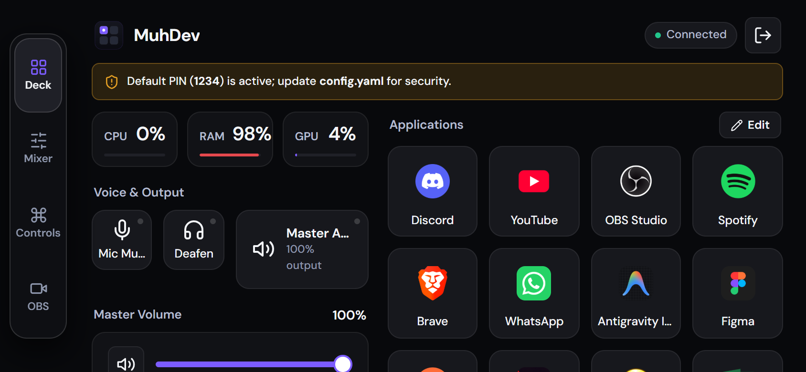
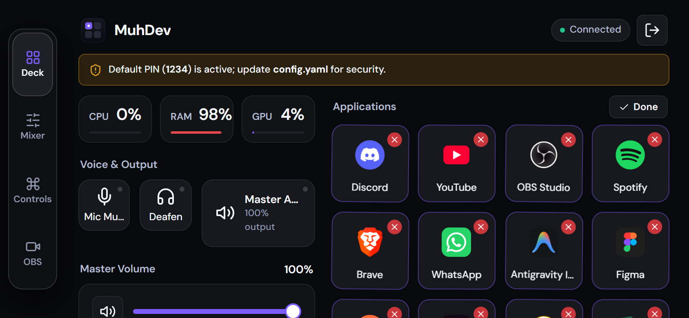
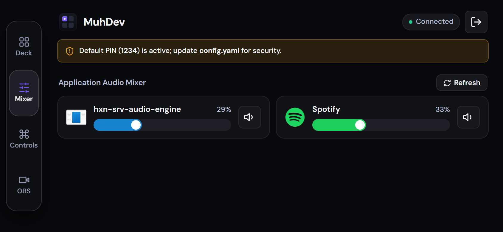
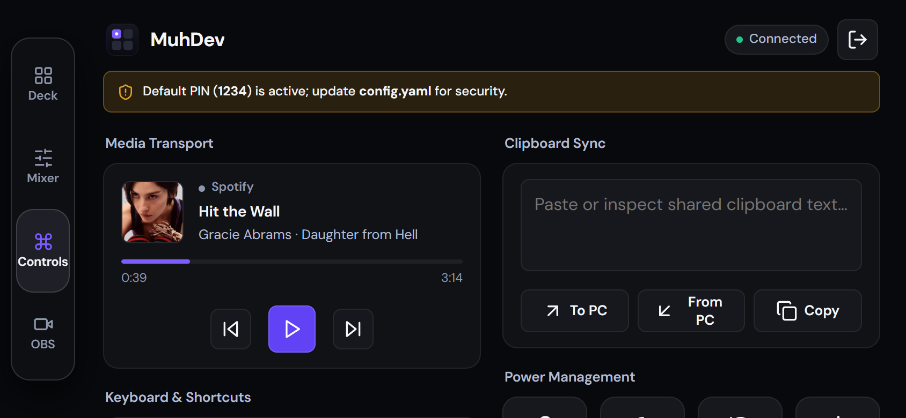
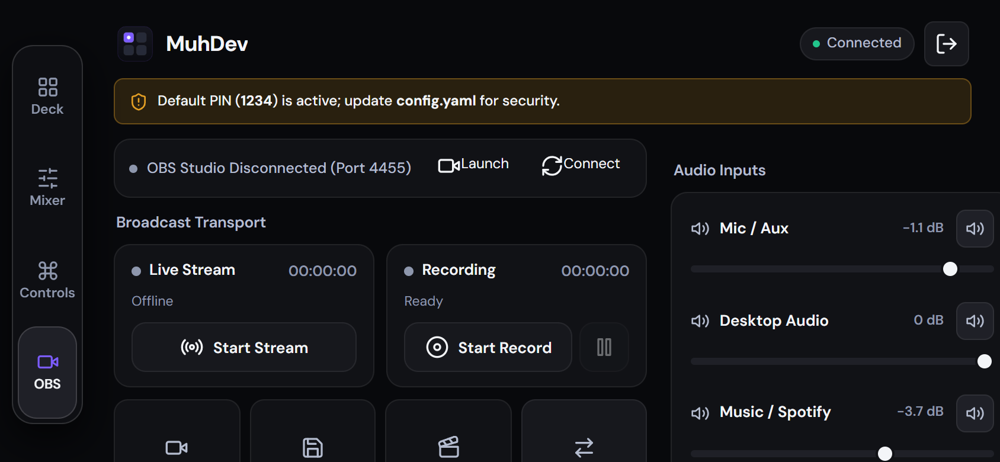
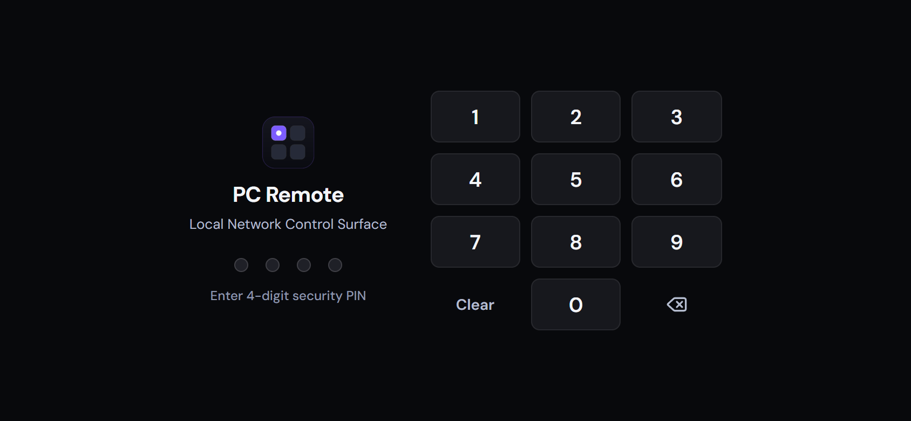

# PocketDeck 🎛️📱

[](LICENSE)
[](https://www.microsoft.com/windows)
[](https://www.python.org/)
[](https://fastapi.tiangolo.com/)
[](https://developer.mozilla.org/en-US/docs/Web/Progressive_web_apps)

> **Low-latency, local-network hardware companion surface served directly from your Windows PC.**  
> Turn your smartphone or tablet into a dedicated, pocket-sized **Stream Deck, Per-Application Audio Mixer, Media Controller, and OBS Studio Cockpit** — used either one-handed in **Portrait** mode or docked next to your monitor in **Landscape Cockpit** mode. Zero cloud subscriptions, zero external telemetry, zero native app store installs.

---

## 📸 Screenshots (Landscape Cockpit View)

*Captured directly on mobile device in Landscape Cockpit mode (viewport-only, zero browser chrome).*

### 1. Main Deck & Live Hardware Telemetry
*Real-time CPU/RAM/GPU telemetry dials, Discord Quick Mute & Deafen toggles, Master volume control, and high-frequency application launch keycaps with native Windows iconography.*


### 2. Deck Editor (CRUD & Drag-and-Drop Reordering)
*Live editing surface to reorder keys via touch drag-and-drop, delete presets with undo toast protection, search installed Windows Start Menu applications (`Get-StartApps`), and upload custom PNG keycaps.*


### 3. Per-App Windows Audio Mixer
*Hardware-grade audio control surface powered by Windows CoreAudio (`pycaw`). Control individual volume levels for Spotify, games, Discord, and browsers with live process iconography and instant mute switches.*


### 4. Windows Media Transport & Productivity Surface
*Windows Global System Media Transport Controls (GSMTC) integration with real-time album artwork and track scrub bar. Includes remote clipboard synchronization, quick productivity keystrokes, and press-and-hold power controls.*


### 5. OBS Studio Cockpit
*Direct OBS WebSocket v5 integration with zero manual token configuration. Control streaming, recording, and replay buffers; switch scenes; toggle source visibility; and adjust individual audio faders with live dB indicators.*


### 6. Security & Authentication
*Local network protection with 4-digit PIN authentication (SHA-256 hashed) and Bearer session tokens.*


---

## ✨ Features

- 🎛️ **Stream Deck & Launcher:**
  - Launch Win32 executables (`.exe`), Windows Store/UWP applications, Steam games (`steam://`), folders, and URLs.
  - Automatic extraction of high-resolution application icons directly from `.exe` resource tables and Windows AppX packages.
  - In-browser Deck Editor: drag-and-drop keycap sorting, discovery search of installed Windows apps, and custom icon uploading.
- 🔊 **Per-App Audio Mixer (`pycaw`):**
  - Adjust individual application volumes independently in real time without minimizing games.
  - Dedicated master volume slider with one-tap instant mute.
  - Global Discord hotkeys for instant **Mic Mute** and **Deafen**.
- 🎬 **OBS Studio Control Surface:**
  - Automatic credential discovery from `%APPDATA%\obs-studio\plugin_config\obs-websocket\config.json`.
  - Live transport: Toggle Stream, Record (with pause), Virtual Camera, and Replay Buffer (with one-tap save).
  - Scene switching and source visibility toggles.
  - Audio input mixer faders with decibel (dB) readouts and mute switches.
- 🎵 **Windows Media Controller (GSMTC):**
  - Two-way media synchronization with Spotify, Apple Music, YouTube, and media players.
  - Real-time track title, artist, album metadata, timeline scrub bar, and high-resolution album artwork.
  - Hardware media keys: Play/Pause, Next Track, Previous Track.
- ⚡ **System Controls & Virtual Trackpad:**
  - Remote clipboard synchronization: Read from or write directly to the Windows clipboard with optional instant-paste.
  - Common desktop shortcuts: Copy, Paste, Cut, Undo, Select All, and remote text typing.
  - Touchpad surface for relative cursor movement, left/right clicks, double click, and scroll wheel.
- 🛡️ **Guarded Power Management:**
  - Workstation Lock, Sleep, Shutdown, Restart, and Cancel Shutdown.
  - Protected by a 2-second **Press-and-Hold** confirmation button to prevent accidental clicks.
- 📊 **Multi-Tier Hardware Telemetry:**
  - CPU usage % (`psutil`).
  - RAM usage % and used/total memory stats.
  - 3-tier GPU monitoring: NVML direct ctypes (microsecond NVIDIA latency) $\to$ `nvidia-smi` CLI $\to$ Windows Performance Counters (`typeperf` for Intel Arc & AMD Radeon).
- 📱 **Progressive Web App (PWA):**
  - Zero build step required (Vanilla ES6 modules + native CSS design tokens).
  - Add to Home Screen on iOS Safari and Android Chrome for an app-like, borderless fullscreen cockpit.

---

## 🚀 Quick Start

### Prerequisites
- **Operating System:** Windows 10 or Windows 11 (64-bit)
- **Python:** Python 3.13 or newer ([Download Python 3.13](https://www.python.org/downloads/)) — *ensure you check "Add Python to PATH" during installation.*

---

### Installation

#### Method 1: One-Click Setup (Recommended)
1. Clone or download this repository:
   ```bash
   git clone https://github.com/MuhDev/pocketdeck.git
   cd pocketdeck
   ```
2. Double-click **`setup.bat`**.  
   *This automatically creates the Python virtual environment (`venv`), installs all required dependencies, and sets up your default `config.yaml`.*
3. Double-click **`run.bat`** to start the server.

#### Method 2: Manual Setup
```powershell
# 1. Create and activate a virtual environment
python -m venv venv
.\venv\Scripts\activate

# 2. Upgrade pip and install dependencies
python -m pip install --upgrade pip
pip install -r requirements.txt

# 3. Initialize configuration
copy config.example.yaml config.yaml

# 4. Start the server
python -m server.main
```

---

## 📱 Connecting Your Phone

1. Ensure your smartphone or tablet is connected to the **same local Wi-Fi / network** as your Windows PC.
2. Find your PC's local IP address:
   - Open PowerShell or Command Prompt and run `ipconfig`.
   - Look for the **IPv4 Address** (typically `192.168.x.x` or `10.0.x.x`).
3. Open your mobile browser and navigate to:
   ```
   http://<YOUR-PC-IP>:8765
   ```
   *(Example: `http://192.168.1.50:8765`)*
4. Enter the default PIN: **`1234`**
5. **Install as PWA (Optional but recommended):**
   - **iOS Safari:** Tap the **Share** button $\to$ tap **Add to Home Screen**.
   - **Android Chrome:** Tap the **Menu (⋮)** $\to$ tap **Install app** or **Add to Home screen**.
6. Rotate your phone horizontally into **Landscape** mode to engage the dedicated **Cockpit Layout**!

---

## ⚙️ Configuration

All user settings, Discord keybinds, and deck presets are managed in `config.yaml`:

```yaml
server:
  host: "0.0.0.0"
  port: 8765
  # SHA-256 hash of your 4-digit security PIN. Default is '1234'
  pin_hash: "03ac674216f3e15c761ee1a5e255f067953623c8b388b4459e13f978d7c846f4"

discord:
  # Configure these in Discord -> Settings -> Keybinds
  mute_hotkey: ["ctrl", "shift", "alt", "m"]
  deafen_hotkey: ["ctrl", "shift", "alt", "u"]

presets:
  - id: discord
    name: Discord
    type: app
    target: '%LOCALAPPDATA%\Discord\Update.exe'
    args:
      - --processStart
      - Discord.exe
  - id: spotify
    name: Spotify
    type: shell_app
    target: SpotifyAB.SpotifyMusic_zpdnekdrzrea0!Spotify
```

### Changing Your Security PIN
To set a custom PIN (e.g. `5678`), generate its SHA-256 hash using Python:
```bash
python -c "import hashlib; print(hashlib.sha256(b'5678').hexdigest())"
```
Paste the output into `pin_hash` inside `config.yaml` and restart the server.

### Configuring Discord Hotkeys
1. In the Discord desktop client, open **User Settings** $\to$ **Keybinds**.
2. Click **Add a Keybind**:
   - **Action:** `Toggle Mute` $\to$ **Keybind:** `Ctrl + Shift + Alt + M`
3. Click **Add a Keybind**:
   - **Action:** `Toggle Deafen` $\to$ **Keybind:** `Ctrl + Shift + Alt + U`
4. These match the default hotkeys in `config.yaml`.

### OBS Studio Setup
1. In OBS Studio, navigate to **Tools** $\to$ **WebSocket Server Settings**.
2. Check **Enable WebSocket server** (default port: `4455`).
3. PocketDeck will automatically detect the port and password from your local OBS installation files without manual entry!

---

## 🛠️ Architecture & Contributing

PocketDeck is built with a zero-compilation philosophy:
- **Backend:** Python 3.13+ with FastAPI, Uvicorn, and native Windows bindings (`pycaw`, `comtypes`, `pynput`, `psutil`).
- **COM Apartment Safety:** Windows CoreAudio calls execute in a dedicated STA background worker (`AudioCOMThread`) to prevent COM concurrency violations.
- **Frontend:** Pure Vanilla JavaScript (ES modules) and native CSS design tokens. No Node.js build step or bundler needed.

For complete architectural details, module tours, and step-by-step guides on adding new features or integrations, read [DEVELOPMENT.md](DEVELOPMENT.md).

Contributions are warmly welcomed! Please read [CONTRIBUTING.md](CONTRIBUTING.md) for contribution guidelines.

---

## 🔒 Security Model

- **Local Network Only:** The server binds to local interfaces (`0.0.0.0`) and is intended for use inside trusted home or office Wi-Fi networks. Do not expose port 8765 directly to the public Internet without a reverse proxy (e.g., WireGuard, Tailscale, or Cloudflare Tunnel with authentication).
- **PIN Verification:** All protected API endpoints require an active Bearer session token issued upon entering the correct SHA-256 hashed PIN.
- **Power Action Guard:** Dangerous actions (Shutdown, Restart) require explicit 2-second press-and-hold confirmation to prevent misclicks.

---

## 📄 License & Author

Developed with care by **Mohammed Al-attas**.  
Released under the [MIT License](LICENSE).
